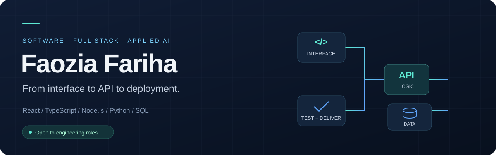

  

  
  
  

## Hi, I'm Faozia

I'm a Computer Science graduate from **CUET**, focused on **software engineering and full-stack development**. My projects span interactive React interfaces, backend APIs, database workflows, automated testing, and containerized delivery. I also explore applied AI and model-serving systems.

**Open to software engineer and full-stack engineer opportunities.** Start with the projects below to explore the applications, source code, and engineering decisions.

## Featured project · ThesisFlow

### An academic workflow, connected from proposal to review

**React · TypeScript · Express · PostgreSQL / SQLite · Docker · GitHub Actions**

A thesis and project management portal with separate student, supervisor, and administrator workflows. Explore proposal review, progress tracking, versioned PDF submissions, feedback, and academic deadlines.

| Application | Engineering |
| :--- | :--- |
| Three role-specific workspaces | Server-side role and ownership checks |
| Proposal → review → progress → completion | Validated API inputs and parameterized SQL |
| Document history and supervisor feedback | API integration tests and Playwright workflows |
| Seeded accounts for exploring the demo | Docker packaging and a GitHub Actions pipeline |

**[Explore the demo ↗](https://thesisflow-wine.vercel.app)** · **[Read the code](https://github.com/faoziafariha/ThesisFlow)** · **[Architecture](https://github.com/faoziafariha/ThesisFlow/blob/main/docs/ARCHITECTURE.md)** · **[Tests & CI](https://github.com/faoziafariha/ThesisFlow/actions)**

A portfolio engineering extension of the CUET Thesis & Project Portal. Original academic contributors: Faozia Fariha, Arpita Mallik, and Ratnajit Dhar. [Project provenance](https://github.com/faoziafariha/ThesisFlow/blob/main/docs/PROVENANCE.md).

## More selected work

<table>
<tr>
<td width="50%" valign="top">

### CareDesk
**Clinic & pharmacy workflow workspace**

React · TypeScript · Firebase · Node.js

Explore patient updates, care tasks, pharmacy registration, and consent-sharing flows in the browser demo. The separate Firebase clinic implementation includes authenticated callable operations, role checks, audit records, and an AI note-drafting gateway.

**Engineering focus:** workflow design, access control, validation, and documented architecture decisions.

[Demo ↗](https://care-desk-theta.vercel.app) · [Source](https://github.com/faoziafariha/CareDesk) · [Architecture](https://github.com/faoziafariha/CareDesk/blob/main/docs/ARCHITECTURE.md)

Synthetic data only. Public demo uses browser storage and simulated roles; Firebase mode requires separate configuration.

</td>
<td width="50%" valign="top">

### Python Code Runner
**A browser editor connected to a Python API**

React · Monaco Editor · FastAPI · Docker

Write Python in a browser and send it to a FastAPI service for execution in Docker containers. The implementation configures network isolation, memory/CPU limits, a read-only filesystem, and IP-based rate limiting.

**Engineering focus:** frontend/API integration and container resource controls.

[Source & setup ↗](https://github.com/faoziafariha/python-code-runner)

A learning project for code-execution infrastructure; container controls are not a security guarantee for a public execution service.

</td>
</tr>
<tr>
<td width="50%" valign="top">

### NodeScape
**Interactive graph algorithm exploration**

React · TypeScript · Flask · Docker

Visualize breadth-first and depth-first search through an interactive graph interface, with a Python backend and containerized setup.

**Engineering focus:** algorithm visualization, interactive state, and frontend/backend integration.

[Source & setup ↗](https://github.com/faoziafariha/NodeScape-StackTracers)

</td>
<td width="50%" valign="top">

### Legal Document Classifier
**Model serving & observability lab**

Python · FastAPI · Legal-BERT · MLflow · Prometheus · Grafana

A reproducible lab connecting legal-text classification with an HTTP API, experiment tracking, inference metrics, and monitoring dashboards.

**Engineering focus:** the path from an ML model to an observable service.

[Source & walkthrough ↗](https://github.com/faoziafariha/legal-doc-classifier-observability)

</td>
</tr>
</table>

## Technologies in these projects

  
  
  
  
  
  
  
  
  
  

| Area | Project evidence |
| :--- | :--- |
| Frontend | React, TypeScript, responsive interfaces, interactive graph visualization |
| Backend & data | Express, FastAPI, Flask, REST APIs, PostgreSQL, SQLite, Firebase |
| Testing & delivery | Playwright, Vitest, Node.js tests, Docker, GitHub Actions |
| Applied AI | Model serving, Legal-BERT, MLflow, Prometheus, Grafana |

---

**Let's connect.** For engineering opportunities, reach me through [LinkedIn](https://www.linkedin.com/in/faozia-fariha-449771229/) or [email](mailto:faoziafarihaaa@gmail.com).
